# SprintEngine Studio

[](LICENSE)

**One desktop app for every coding agent you already use.** Studio runs Claude
Code, Codex, Cursor, OpenCode and others side by side against the same
repository, keeps every session when you close the window, and gives the agents
a backlog, a canvas, a browser and a pool of worktrees to work with.

<picture>
  <source media="(prefers-color-scheme: dark)" srcset="docs/images/readme/hero-dark.png">
  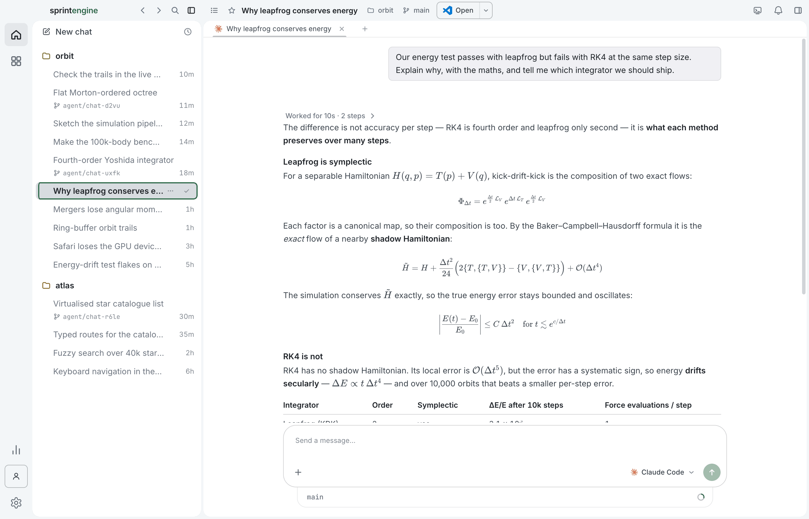
</picture>

## A look around

### Maths that reads like maths

Replies render LaTeX through KaTeX, inline and on display lines, next to tables,
code and the steps the agent took to get there.

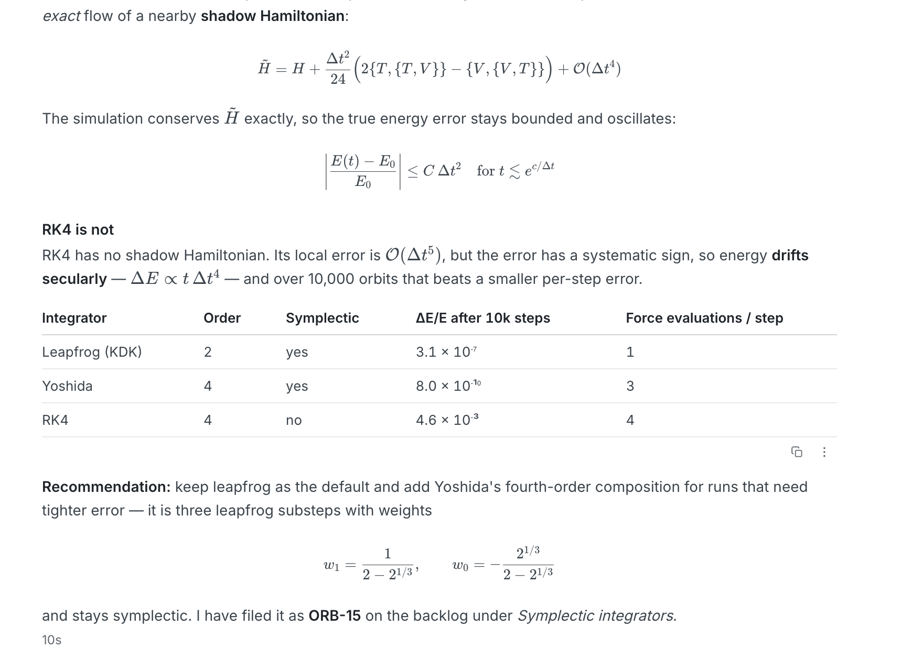

### Agents that fan out

A chat can send work off to several agents at once. Each one shows what it is
doing, how long it took and what it spent, and the Agents pane keeps the whole
roster in view.

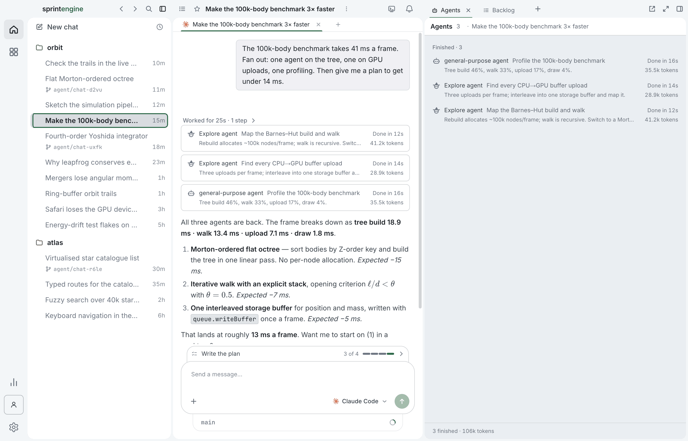

### A canvas the agent draws on

Ask for a diagram and the agent builds it on an Excalidraw board beside the chat.
It is an ordinary board: move things around and the agent reads your edits back.

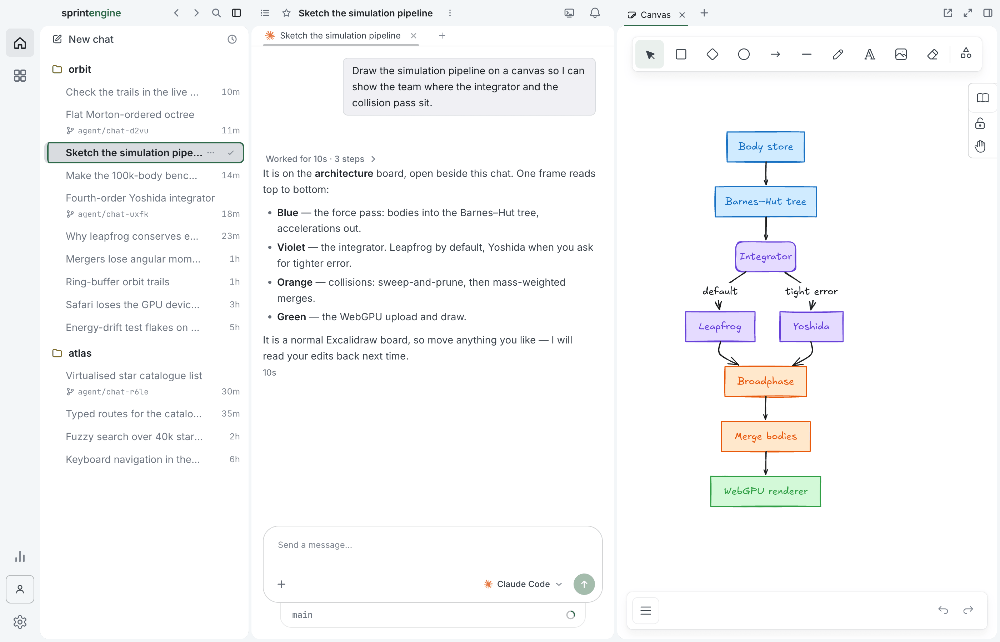

### A browser the agent drives, and a window onto it

Agents open, read and click through pages in a built-in browser. When the pane is
closed, a live miniature floats over the chat, so you can always see what the
agent is looking at.

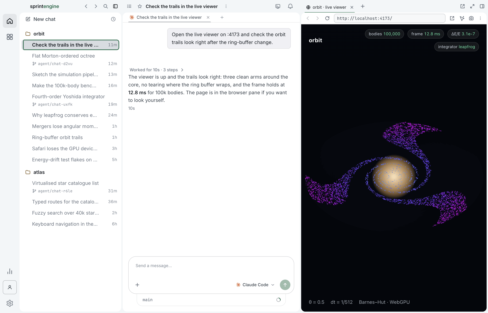

<p align="center">
  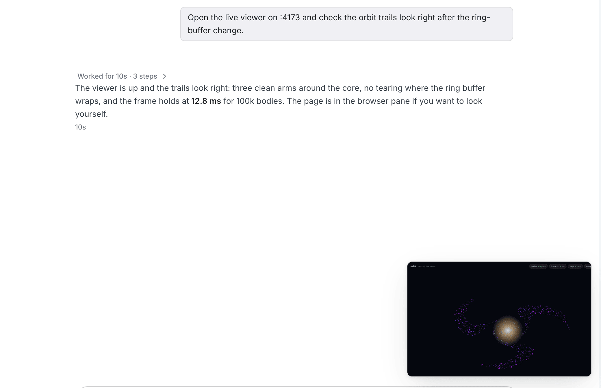
</p>

### A backlog that lives in your repository

Items are markdown files under `backlog/`, grouped into epics, with status,
effort and risk at a glance. Agents read, triage and pick up work from it, and
every change is a diff you can review.

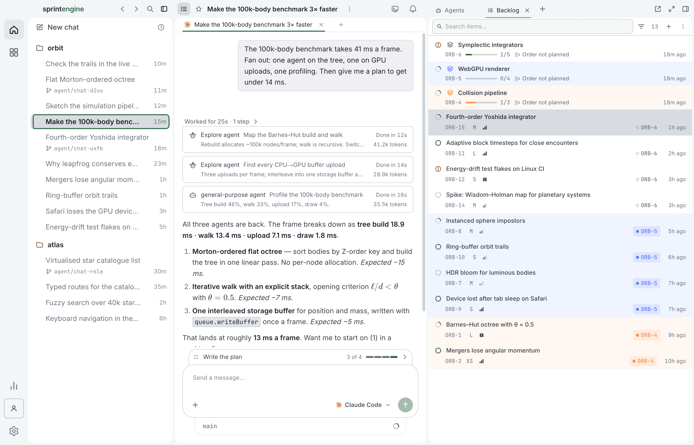

### A pool of worktrees

Every chat can run in a worktree of its own. Finished worktrees go back into a
pool and are reset for the next chat, with `node_modules` and build output kept
so installs are quick. A worktree in use or holding uncommitted work is never
removed.

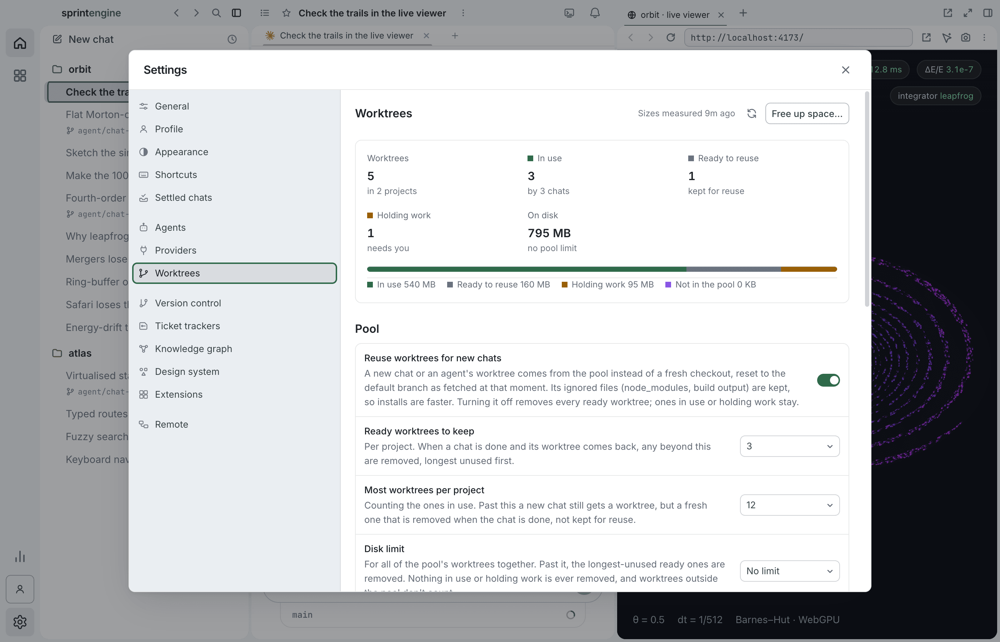

### Start anything from one box

Pick a project, an agent and whether it gets its own worktree, or start from a
ready-made task.

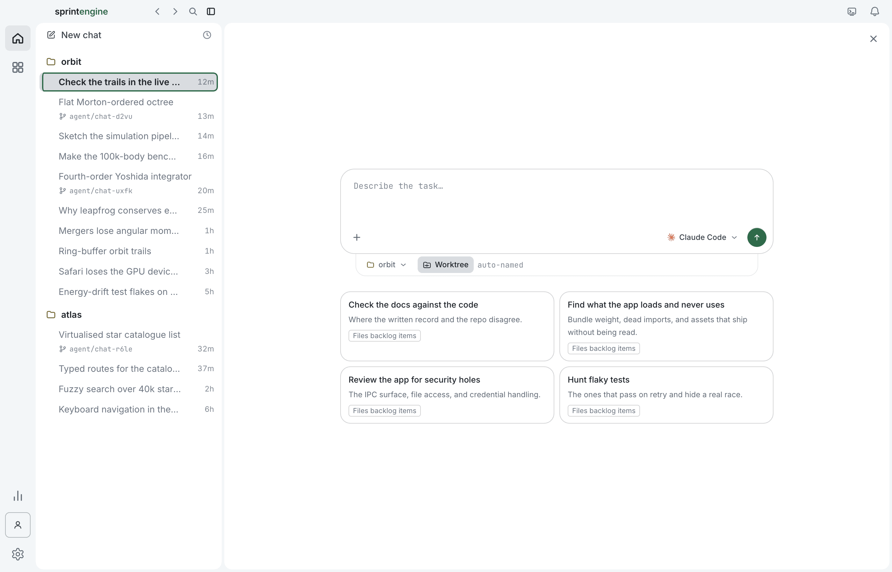

### Extensions, plugins and skills

Browse plugin and skill marketplaces and install from one place, or describe an extension and have an agent build it with you on the
[module SDK](packages/module-sdk).

<p>
  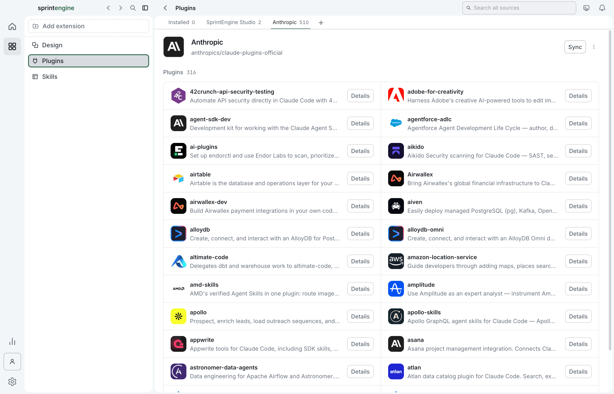
  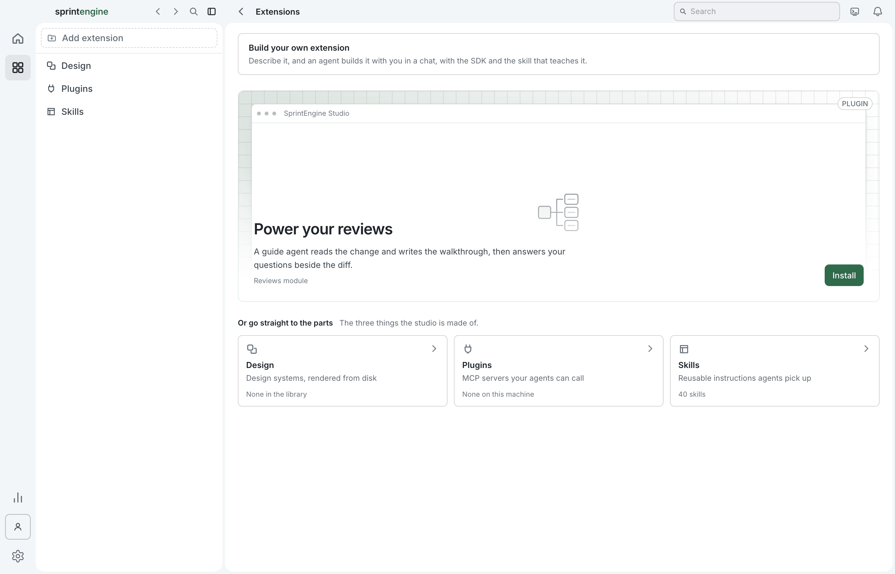
</p>

### Themes

Eleven themes, light and dark, all drawn from the same design system.

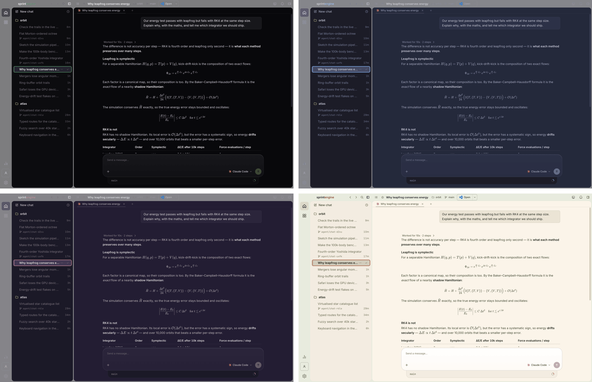

## What else is in the box

Code review with a guide agent, a design-system door, a memory graph, scheduled
and triggered automations, remote machines over SSH and your tailnet, and a
companion app for driving all of it from your phone.

The app is an Electron desktop app with a React renderer and a TypeScript main
process.

## Running it

Build it from source — see [CONTRIBUTING.md](CONTRIBUTING.md) for the toolchain
and `npm run dev`. No account is needed to run it.

Prebuilt installers for macOS, Windows and Linux are not published yet.

## The agent CLIs it drives

Each of these ships as a plugin manifest under `resources/plugins/`, which is
what the app reads to find, launch and update the CLI. The CLI itself is not
bundled — the app detects the binary on your `PATH` and can install or update it
for you.

| Agent CLI | Binary |
| --- | --- |
| Claude Code | `claude` |
| Codex | `codex` |
| Cursor | `cursor-agent` |
| Grok Build | `grok` |
| Kimi Code | `kimi` |
| Muse Code | `muse` |
| OpenCode | `opencode` |
| Kimi K3 | `claude`, pointed at Moonshot |
| Z.AI | `claude`, pointed at Z.AI |
| Generic Shell | `sh`, for driving any command-line program as an agent |

Alongside those, three model providers are available for the app's own
conversation agents: the Claude Agent SDK harness, OpenRouter and xAI.

Adding another CLI does not require changing the app. A plugin manifest is
enough — see [docs/plugin-authors/README.md](docs/plugin-authors/README.md).

## Building from source

You need **Node 22** (there is a `.nvmrc`) and npm.

```
git clone https://github.com/sprintengine/studio.git
cd studio
npm ci
npm run dev
```

`npm run dev` starts the main process and the renderer dev server together. It
uses port 5173, or the next free port if that one is taken, in which case the
second instance gets its own profile so you can run two side by side.

```
npm run build          # compile main, preload and renderer
npm run dist:mac       # package an installer — also dist:win, dist:linux
npm run verify:app     # the full gate: typecheck, lints, tests, SDK and feed checks
```

The `dist:*` scripts fetch the bundled agent runtimes first, so the first run of
one needs network access and takes a while.

## How the pieces are laid out

| Path | What is in it |
| --- | --- |
| `src/main` | The Electron main process: agent launch and state, terminal and conversation runtimes, the capability-module host, the plugin registry, CLI detection and installation, MCP configuration, the workspace registry, and the IPC handlers. |
| `src/preload` | The preload bridge — the typed API surface the renderer is allowed to call. |
| `src/renderer` | The React user interface. |
| `src/shared` | Types and contracts shared across processes, including the IPC contract and the plugin and skill manifest schemas. Deliberately free of Node APIs. |
| `packages/module-sdk` | The published SDK for building capability modules and BYO-CLI plugins: manifest and permission types, host contribution points, and bundle signing. MIT licensed. |
| `resources/` | Everything bundled with the app rather than compiled into it: the agent CLI plugin manifests, the marketplace registry, MCP definitions, hooks, the studio plugin and its skills, the fetched agent runtimes, and the app icons. |
| `design-system/` | A self-contained, framework-neutral design system — tokens, components, patterns and a catalog — with its own lint that the app's build gates enforce. |

## Extending it

The app is meant to be built on rather than only used.

- **Capability modules** contribute to the main and renderer hosts — new
  workspace types, automation providers, notifications, panels. Start with
  [docs/module-authors/drop-in-extensions.md](docs/module-authors/drop-in-extensions.md)
  for how the app discovers a module you drop on disk, and
  [docs/module-authors/permissions.md](docs/module-authors/permissions.md) for
  what the permission vocabulary means.
- **CLI plugins** teach the app to drive an agent CLI it has never seen: how to
  launch it, how to write its MCP config, how to install skills for it, and how
  to tell when a turn is finished.
  [docs/plugin-authors/README.md](docs/plugin-authors/README.md) covers manifests
  and signed bundles.
- **The studio's own agent-facing surface** — the `sprintengine-studio` plugin
  the app installs into every workspace it opens, the stdio bridge to the
  running app, and the opt-in skills that teach an agent to drive it — is documented in
  [resources/studio-plugin/README.md](resources/studio-plugin/README.md).

Both kinds of extension are built against
[`packages/module-sdk`](packages/module-sdk).

## Uninstalling

There is nothing to do before you delete Studio. So the agent CLIs it launches
can report to it, Studio writes hooks and an MCP server entry into the
repositories you open, and a small launcher at `~/.sprintengine/bin` that they
run. It writes them when an agent needs them and takes them back out every time
it quits, leaving your own hooks, servers and settings around them as they
were. If Studio does not get to quit cleanly (a crash, a force quit), the next
quit takes them out, and until then the launcher makes any leftover a quiet
no-op rather than an error in your CLI.

A few things are kept across quits because they do their job while Studio is
closed: locks on agent worktrees, `tailscale serve` mappings for ports you
shared, the knowledge-activity hook in repositories where you turned it on, and
Studio's runtime inside any WSL distribution it ran agents in. On Windows the
uninstaller removes these as well, and asks whether to delete Studio's settings
and logs.

## Licence

The repository is licensed under the **MIT License**. You may use, modify and
redistribute it, including in commercial products. The full text is in
[LICENSE](LICENSE).

`packages/module-sdk` and `packages/conversation-protocol` carry their own
MIT licence files as well, so an SDK consumer does not have to take the whole
application tree.

## Contributing

[CONTRIBUTING.md](CONTRIBUTING.md) covers setup, the gates a pull request has to
pass, the design-system rule for anything visual, and the terms contributions
come in under. There is no CLA.

Please also read the [Code of Conduct](CODE_OF_CONDUCT.md). Security
vulnerabilities go through the private process in [SECURITY.md](SECURITY.md),
not the issue tracker.
